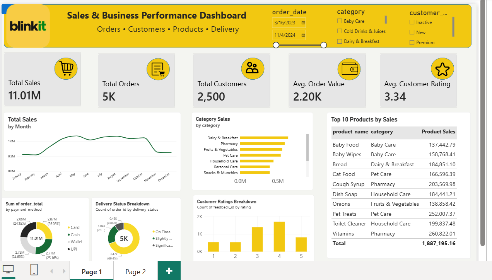
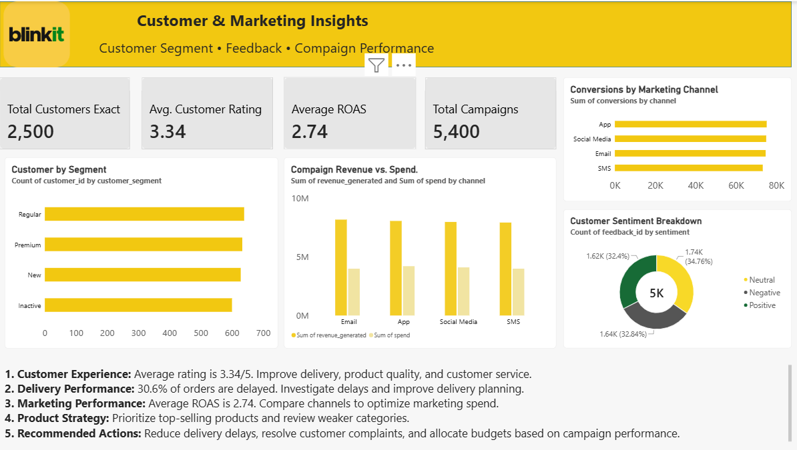

# Blinkit Sales & Business Performance Analysis

## Project Overview
This project analyzes Blinkit's sales, orders, products, customer feedback, delivery performance, and marketing campaign data using PostgreSQL, Microsoft Excel, and Power BI. The objective is to convert business data into insights that can support data-driven decisions.

## Business Objectives
- Analyze monthly sales and order trends.
- Identify top-performing product categories and products.
- Understand payment method distribution.
- Evaluate delivery performance and delays.
- Analyze customer ratings and feedback sentiment.
- Compare marketing channels using revenue, spend, conversions, and ROAS.

## Tools & Technologies
- **PostgreSQL:** Data querying, aggregation, joins, and business analysis.
- **Microsoft Power BI:** Interactive dashboards, KPI cards, charts, and reporting.
- **Microsoft Excel:** Initial data review and preparation.
- **DAX:** Power BI measures and calculations.

## Key Dashboard Metrics
- **Total Sales:** ₹11.01 million
- **Total Orders:** 5,000
- **Total Customers:** 2,500
- **Average Order Value:** ₹2.20K
- **Average Customer Rating:** 3.34/5
- **Marketing Campaign Records:** 5,400

*Metrics reflect the values displayed in the current dashboard. Definitions and calculation logic should be confirmed when comparing metrics across tools.*

## Business Questions
1. How do sales and order volumes change over time?
2. Which product categories and products generate the highest sales?
3. How are orders distributed across payment methods?
4. What proportion of orders are delivered on time or delayed?
5. What do customer ratings and feedback sentiment indicate?
6. How do marketing channels compare in spending, revenue, conversions, and ROAS?

## Business Insights & Recommendations
The dashboard provides a starting point for identifying sales trends, high-performing products, delivery issues, customer experience patterns, and marketing performance.

- **Sales:** Review monthly trends to identify periods of growth or decline.
- **Products:** Prioritize high-performing products and investigate weaker categories.
- **Delivery:** Investigate delayed orders and recurring delay reasons.
- **Customer experience:** Review low ratings and negative feedback to identify improvement opportunities.
- **Marketing:** Compare channel-level ROAS and conversion performance before reallocating budgets.

*These are analysis directions and recommendations, not claims that every pattern has already been conclusively established. Specific findings should be added after reviewing the underlying query results.*

## Project Files
- `SQL/blinkit_analysis.sql` — SQL queries for business analysis.
- `Screenshots/` — Power BI dashboard screenshots (to be added).

## Limitations
This project uses a supplied dataset for portfolio and learning purposes. The findings describe the available data and should not be treated as verified internal Blinkit business results.

## Business Value
This project demonstrates how SQL and Power BI can be used to explore business performance, track KPIs, identify areas for investigation, and communicate insights through dashboards.

## Power BI Dashboard

### Page 1: Sales & Business Performance

### Page 2: Customer & Marketing Insights

